<div align="center">

# 🛰️ Networkwalks Cybersecurity Internship Programme · Week 2 · B084 · Penetration Testing Report

**Footprinting & Network Scanning Phases** · `W2-PM1` + `W2-PM5`


-F59E0B?style=flat-square)


[📄 Read the PDF](report/Networkwalks_W2_Pentest_Report.pdf) ·
[📝 Download the Word version](report/Networkwalks_W2_Pentest_Report.docx) ·
[🗂️ Findings CSV](data/findings.csv)

</div>

---

## What this is

A 20-page penetration-testing report that documents two hands-on labs from the Networkwalks Cybersecurity Internship Program:

| Module | Activity | Target |
|---|---|---|
| **W2-PM1** | Footprinting with six Kali Linux tools: `whois`, `whatweb`, `nslookup`, `curl -I`, `wafw00f`, `dnsrecon` | `networkwalks.com` (written permission) |
| **W2-PM5** | Host discovery with Zenmap (`nmap -sn`) and topology view | `192.168.18.0/24` (my own network) |

Every finding is tied to a screenshot, rated, and paired with a recommendation. **No exploitation, password guessing, fuzzing or port scanning was performed.**

## The short version

| # | Headline | Severity |
|---|---|---|
| F-01 | Exact WordPress (7.1.4), Download Manager (3.3.76) and jQuery (3.7.1) versions are readable from the site | 🟠 Medium |
| F-10 | Camera / IoT-class devices (Hikvision, AI-Link) sit on the same flat LAN as everything else | 🟠 Medium |
| F-02 – F-07, F-11 | REST API advertised, BIND version disclosed, SPF soft-fail, DNSSEC off, shared-hosting layout visible, no HSTS/nosniff/XFO/CSP in the captured headers, 3 randomised-MAC hosts | 🔵 Low |
| F-08, F-09 | ModSecurity identifiable (also a positive control), public contact e-mail | ⚪ Info |

Controls that were already working: HTTP→HTTPS redirect, HTTP/2, `Secure` + `HttpOnly` cookie, ModSecurity WAF, registrar locks, Permissions-Policy and Referrer-Policy headers, two name servers on different IPs.

> These are **observations, not confirmed vulnerabilities**. A version number or an open record does not make a system vulnerable by itself.

## How the work flowed

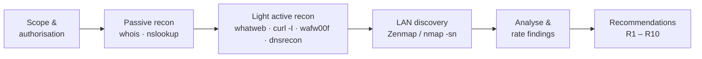

## Evidence gallery

<table>
  <tr>
    <td align="center">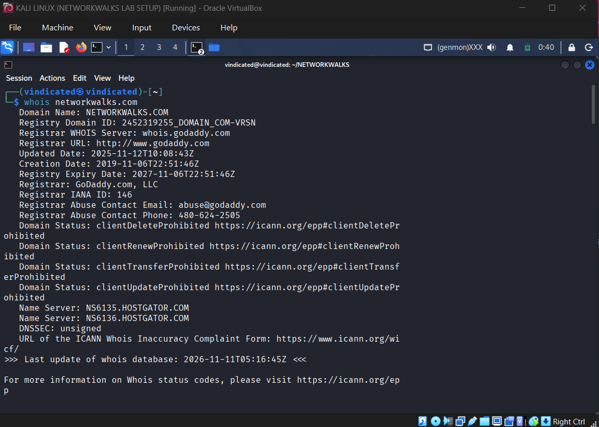<br><sub>WHOIS</sub></td>
    <td align="center">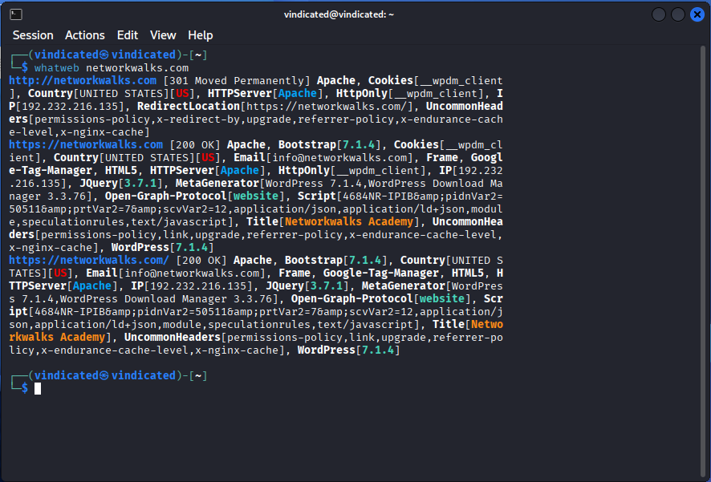<br><sub>WhatWeb</sub></td>
  </tr>
  <tr>
    <td align="center">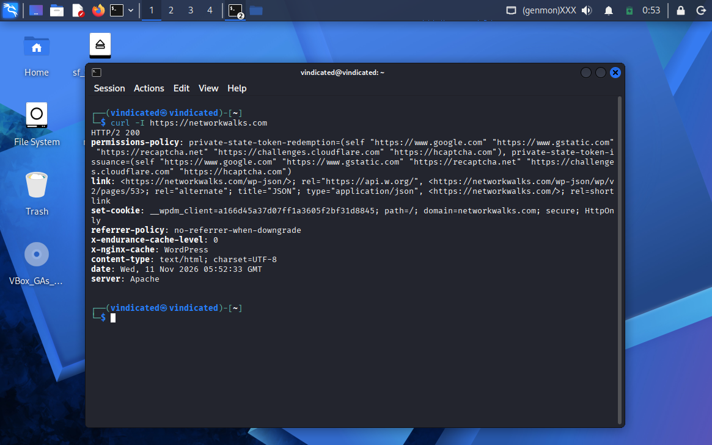<br><sub>curl -I headers</sub></td>
    <td align="center">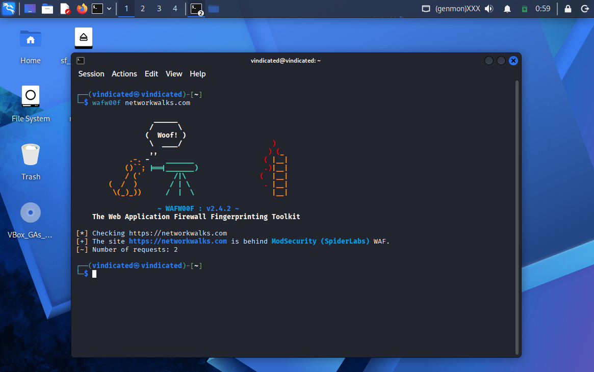<br><sub>wafw00f</sub></td>
  </tr>
  <tr>
    <td align="center">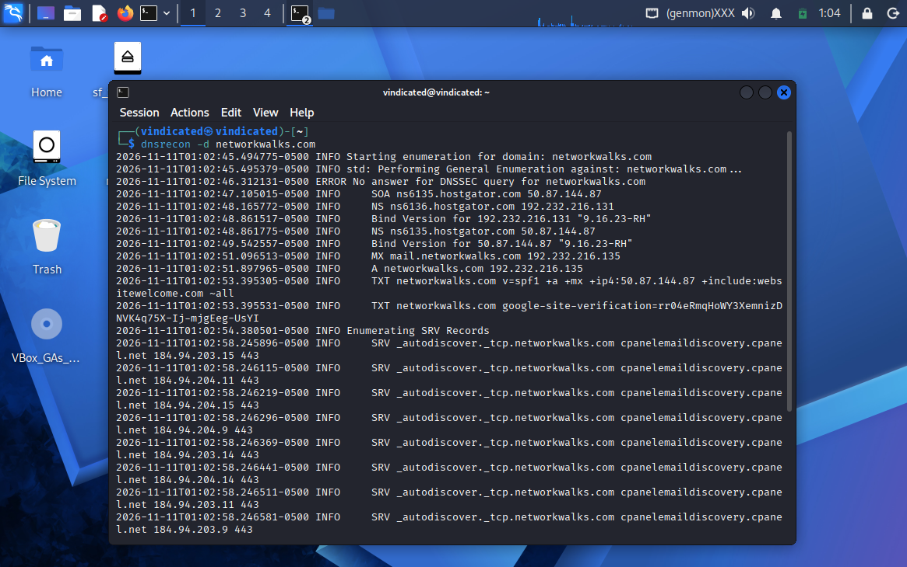<br><sub>DNSRecon</sub></td>
    <td align="center">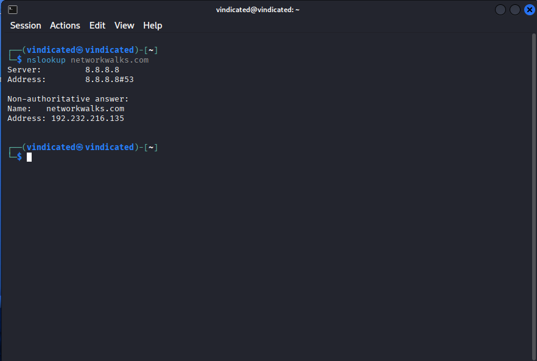<br><sub>Nslookup</sub></td>
  </tr>
  <tr>
    <td align="center">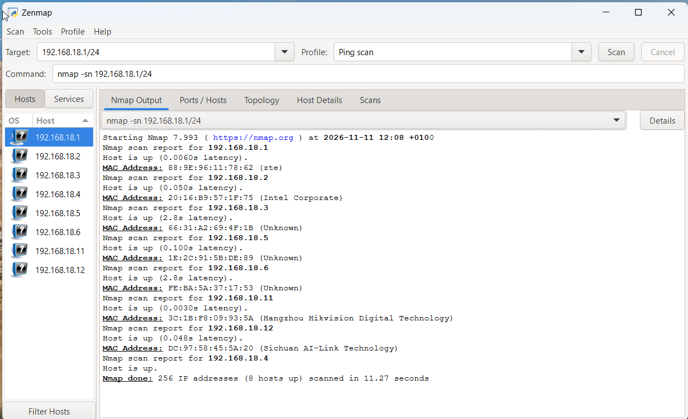<br><sub>Zenmap ping scan</sub></td>
    <td align="center">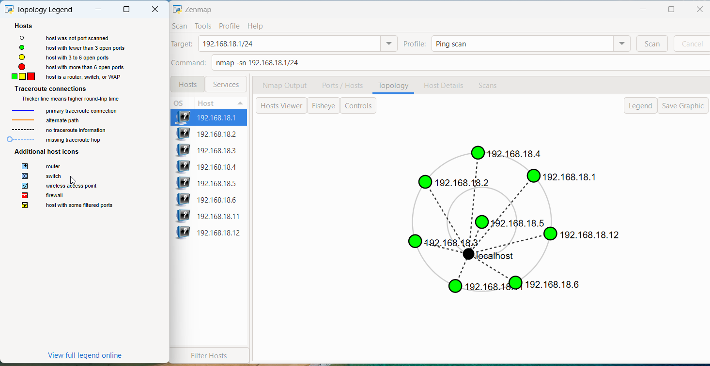<br><sub>Zenmap topology</sub></td>
  </tr>
</table>

### Custom figures built for the report

<p align="center">
  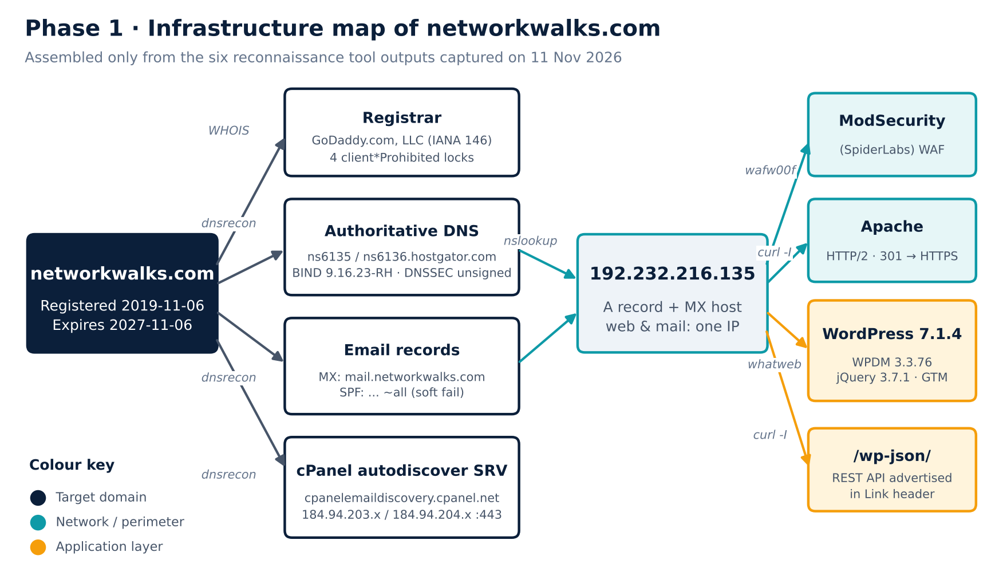<br>
  <sub>Infrastructure map of networkwalks.com assembled from the six tool outputs</sub>
</p>
<p align="center">
  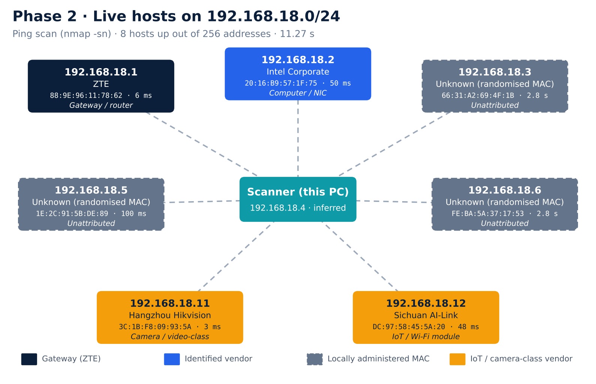<br>
  <sub>The eight live hosts, coloured by what the MAC lookup revealed</sub>
</p>

## Repository layout

```
networkwalks-week2-pentest-report/
├── README.md
├── LICENSE
├── report/
│   ├── Networkwalks_W2_Pentest_Report.docx   # editable Word version
│   └── Networkwalks_W2_Pentest_Report.pdf    # shareable PDF version
├── evidence/
│   ├── 01-whois.png … 08-zenmap-topology.png # original screenshots
│   └── figures/                              # custom diagrams made for the report
├── data/
│   ├── findings.csv                          # the 11-item risk register
│   └── live_hosts.csv                        # the 8 hosts found on the LAN
├── docs/
│   └── commands-cheatsheet.md                # every command, what it does, what to look for
└── scripts/
    ├── run_recon.sh                          # re-run the Phase 1 commands, saving timestamped output
    └── lan_discovery.sh                      # ping-sweep your own LAN and save results for ndiff
```

## Reproduce it (on systems you are allowed to test)

```bash
# Phase 1: footprinting a domain you own or have written permission to test
./scripts/run_recon.sh example.com --i-have-permission

# Phase 2: discover hosts on your OWN network
./scripts/lan_discovery.sh 192.168.1.0/24
```

The first script refuses to run without the `--i-have-permission` flag on purpose. Tools needed: `whois`, `whatweb`, `dnsutils` (nslookup), `curl`, `wafw00f`, `dnsrecon`, `nmap` (all included in Kali Linux).

## Things I learned

- **Tools corroborate each other.** One IP address showed up in three different tools.
- **"Unknown" vendor ≠ rogue device.** Three hosts used *locally administered* (randomised) MAC addresses, which is what many phones do on Wi-Fi.
- **Observation ≠ vulnerability.** A good report separates what was seen, what it could mean, and what to do about it.
- **Scope first.** Written permission before any scan.

## ⚠️ Disclaimer

All activities were performed only on systems I own or have written permission to test. This material is for education and research. Do not use anything here to break the law. Unauthorised access to computer systems is a crime in most countries, even when nothing is damaged. The author, the instructor and Networkwalks are not responsible for how this knowledge is used.

## Author

**Prince Odinakachi Onyeoziri** 
**Cybersecurity Intern B084**
Github [@vindicatedprince](https://github.com/vindicatedprince)
LinkedIn: [https://www.linkedin.com/in/onyeoziri-prince](https://www.linkedin.com/in/onyeoziri-prince-b4387a348/))

---

## 📌 Project Information

**Program Name:** Cybersecurity Internship at Networkwalks | **Week:** 02 | **Project:** FOOTPRINTING & RECONNAISSANCE ATTACKS WITH MULTIPLE KALI TOOLS | **Repository:** GitHub
